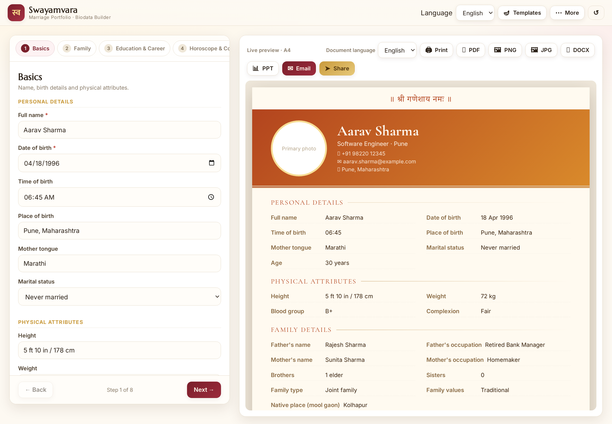

# स्ववृत्त · Swavritta

A free, **fully self-contained** marriage portfolio (biodata) builder for Indian users. One
HTML file, no server, no sign-up, no build step — and **nothing you type ever leaves your device.**

*Swavritta* (स्ववृत्त) is the Hindi and Marathi word for a **biodata** — literally "one's own
account". It is the word Indian families already use for the one-page profile exchanged before a
marriage is discussed, and it is the term taught in school as *स्ववृत्त लेखन*. A fitting name for
a tool that turns your details into a profile you can hand over with confidence.

## Privacy — your data never leaves your device

- **No server, no database, no analytics.** The app's own code has no `fetch`, no
  `XMLHttpRequest`, no `sendBeacon` and no WebSocket. There is no backend to store anything.
- **Your details live in your own browser** (`localStorage`) on your own device, and nowhere
  else. Nothing is uploaded, ever.
- **Zero external requests.** The five JavaScript libraries and every font are bundled inside
  the file, so loading the app contacts no third party at all — no content delivery network, no
  font service. Verified by logging the browser's network activity while loading and using the
  app: **0 HTTP requests.**
- **The shareable link carries the data in the link itself** (the URL fragment after `#`),
  which browsers never send to a web server. Even the site's host never sees it.
- The only things that ever leave the device are the ones *you* choose to send: email (through
  your own mail app), a share to a messaging app, or a link you copy and paste somewhere.

Because the data is device-local, anyone with access to that device or browser profile could
open the app and see it, and clearing browser data erases it — the trade-off of keeping it off
every server.

**About the bundled libraries.** The file includes five open-source JavaScript libraries, kept
in full so that exports work offline. Their code retains the original authors' names and
licence notices, as those licences require. They are inert — no organisation is named anywhere
in the app's own content, sample data or interface text.

## Features

- **Wedding banner garland** — a mango-leaf *toran* (तोरण) with a floral pendant and corner
  sprays across the top of every design, drawn in the template's own colours. Switch it off
  from the Template library if you prefer a plain banner.
- **Sample preview** — tap **Sample** to see any design filled with example content before you
  type a single detail. Your own entries are never touched, and the Template library opens
  beside the live preview so you can compare designs at a glance.
- **8-step guided form** — Basics, Family, Education & Career, Horoscope & Community,
  Lifestyle, Partner Preferences, Photos, Contact — with a live A4 preview beside it.
- **Four languages** — English, हिन्दी, मराठी and संस्कृतम् — switchable instantly without
  losing data. A separate *document language* selector lets you fill the form in English and
  export the portfolio in Marathi, and so on. The sample preview follows the document language.
- **13 templates** — Marathi Patta, Royal Rajwadi, Elegant Minimal, Floral Pastel, Modern
  Corporate, Temple Gold, Peacock Motif, Classic Ivory, and five floral designs: **Floral Vine,
  Rose Trellis, Paisley Embroidery, Marigold Festive and Lotus Pond**.
- **Floral & embroidery motifs** — layer a hand-drawn decorative motif onto *any* template:
  floral vine, rose trellis, paisley embroidery, lotus, mandala or marigold garland. Each motif
  is drawn in the template's own accent colour and can be swapped or removed at any time.
- **Accent colour and typeface pickers**, plus an optional "॥ श्री गणेशाय नमः ॥" invocation banner.
- **Exports** — PDF (multi-page A4), PNG, JPG, DOCX, and an **editable** PPTX that keeps its
  text editable in a slide editor.
- **Email & share** — email the portfolio, share to a messaging app, or create a self-contained
  **read-only link** that anyone can view and download. Anyone opening that link can tap
  **Edit** to load the portfolio straight into the editor and carry on from there.
- **Reset and Back buttons** — clear the form and start again, or jump from the preview back to
  the editor, without losing your chosen language or design.
- **India-specific biodata fields** — gotra, rashi, nakshatra, gana, nadi, manglik status,
  mool gaon, family values, diet, and more.
- **Privacy toggles** — hide income, contact details or horoscope from the shared copy.
- **Optional extras** — save/load your data as a `.json` file, and an indicative Ashtakoot
  (36-point) Guna Milan calculator for Kundli matching.
- Autosaves to the device, mobile-first, with a clean print stylesheet.

## How to run

Download `index.html` and open it in any browser — online or completely offline. That's it.

Or use the hosted version: **https://dennysonkusale-png.github.io/swayamvara/**

Because everything is bundled, the file is about 2.1 MB. That is the price of making zero
external requests; nothing else needs to be downloaded afterwards, and exports work with no
internet connection.

## Notes

- All data stays in your browser (`localStorage`). Nothing is uploaded anywhere.
- Email sending is disabled by default: the app saves the PDF and opens your own mail client.
  To send directly from the app instead, define `window.sendMailViaService({to, subject,
  message})` in the code and set `MAIL_SERVICE.enabled = true`. Doing so would route mail
  through whichever service you choose.
- The banner garland and floral motifs appear in the on-screen preview and in the PDF, PNG and
  JPG exports. The DOCX and PPTX files carry the text and structure, not the ornamental artwork.
- The Guna Milan calculator uses commonly published Ashtakoot tables and is indicative only.
  Please confirm with a qualified astrologer before making any decision.

## License

[MIT](LICENSE)
